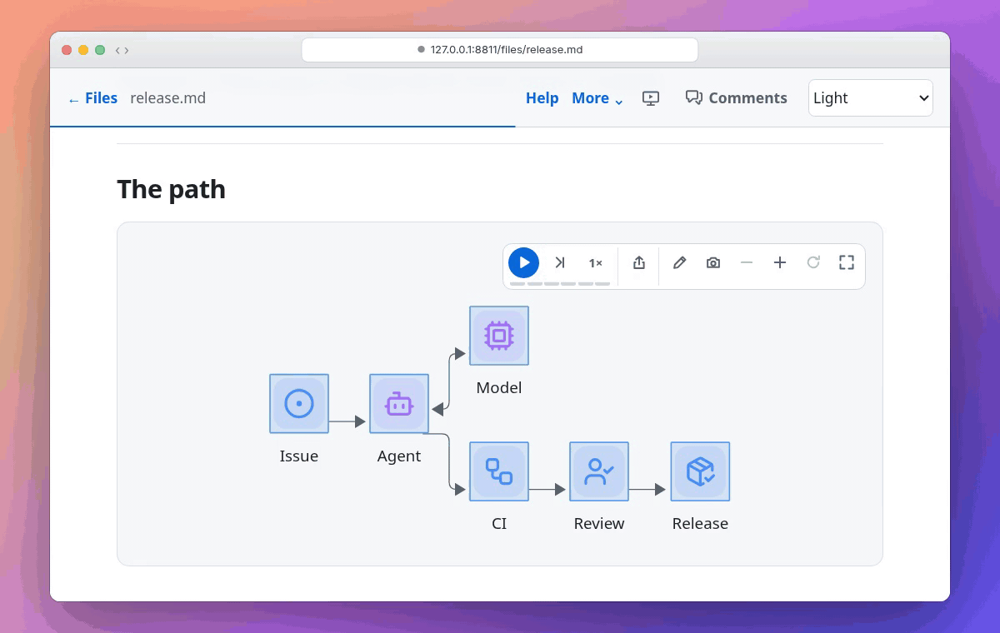
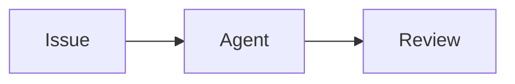

# aniflow

aniflow makes Markdown presentations with animated diagrams. Write your slides
in Markdown, add a logo, and present them in your browser. Mermaid diagrams
can play as walkthroughs: a dot travels along the arrows, boxes light up, and
captions explain each step.

It comes as a small command that serves a folder of Markdown files, and as a
JavaScript library other apps can embed.

Browse the [presentation gallery](https://chmouel.github.io/aniflow/gallery/)
or [try the editor](https://chmouel.github.io/aniflow/try/) in your browser.



## Run it

Browse the Markdown in the current directory and its subfolders:

```sh
uvx --from git+https://github.com/chmouel/aniflow aniflow
```

Open the URL it prints; it picks an available local port. To serve another
directory or choose the port:

```sh
aniflow ./docs --port 8080
```

To keep it installed, run `uv tool install git+https://github.com/chmouel/aniflow`.

## Make a presentation

Create a starter deck and open its folder:

```sh
aniflow --init talk.md              # --style keynote, conference or minimal
aniflow .
```

Edit `talk.md`, open it in aniflow and press Present. Each `##` heading starts
a slide; Space walks through reveals and animated diagrams, while the left and
right arrows change slides. A deck can start as simply as:

```markdown
---
title: Shipping with bots
author: Chmouel
style: conference
logo: ./logo.svg
---

## The problem

Too much waiting between steps.
```

Add `motion: none` to turn off slide animation. Press `s` while presenting for
speaker notes, and use `aniflow --slides pdf talk.md` or `--slides png` to
export a deck. `aniflow --spec` documents branding, layouts and transitions.

Documents get syntax highlighting, colour themes, a table of contents and
interactive Mermaid flowcharts. Relative links and images stay relative to
each document, including pictures in flowcharts, and the built-in `/icons/`
pictures work too.

<p align="center">
  
  
</p>

aniflow binds to `127.0.0.1` by default; use `--host` to change that. It only
reads files from the chosen directory, leaving out hidden paths and symlinks
that lead outside it. It needs Python 3.12 or newer and nothing else.

Behind a reverse proxy that serves it at a path, start it with `--base /pub`:
the prefix then goes into every URL it writes, so a Caddy `handle /pub/*` or an
ingress path rule reaches the pages, stylesheets and icons. `--no-comments`
turns the review UI and the comment routes off, which is what a public reader
wants since comments are written to a cache directory.

Demo & help opens a playable diagram first, followed by a walkthrough from
your first Markdown file to pictures, several stories and exports. It ships
with aniflow and works even when you serve an empty folder.

Use Comments on any page, including the demo, to comment on source lines or
on a box or arrow in a diagram, edit or delete feedback, and copy it with the
quoted text for a coding agent. Comments are kept in `$XDG_CACHE_HOME/aniflow`
(usually `~/.cache/aniflow`), one file per served folder and document.
Reading and commenting leave your source files untouched.

Name the reader after the notes it serves with `--brand "My Notes"` and point
`--logo` at a picture (a path inside the served folder, an https URL or a
`data:` image); a `logo.svg` or `logo.png` at the top of the folder is picked
up without a flag, and the two replace the aniflow wordmark and tab icon. The tab
icon can be its own picture: `--favicon`, or `favicon.svg`, `favicon.png` or
`favicon.ico` at the top of the folder. Pictures dropped there show up on the
next page load, without a restart. The demo card only shows in an empty folder.

Serving a folder to other people, start the server with `--github-oauth
CLIENT_ID`, an OAuth app whose callback is `<public-url>/auth/github/callback`,
and the two secrets in `ANIFLOW_GITHUB_SECRET` and `ANIFLOW_SIGNIN_SECRET`.
Reading stays open; writing needs a GitHub account, a comment belongs to the
account that wrote it, and `--comments-admin LOGIN` may edit anyone's.
`--github-org ORG` keeps the sign-in to members of a GitHub organisation;
if the organisation restricts OAuth apps, an owner has to approve yours. Add
`--base /pub` to mount all of it under a path, or `--no-comments` to turn the
comments off altogether.

With `--user-folders` as well, the people who sign in write too: each gets a
folder named after their GitHub login, with a welcome note showing the
Markdown and the diagrams, and an **Edit** button on their notes that opens
the Markdown beside the live page. Everyone reads everything; a folder is
writable by all members once it holds a `.aniflow-shared` file
(`touch notes/team/.aniflow-shared`), which the web cannot create.

Scripts and agents write with an API token, made under **API tokens** in the
account menu (shown once, 90 days, revocable). It carries exactly its owner's
rights:

```sh
curl -X PUT -H "Authorization: Bearer $ANIFLOW_TOKEN" --data-binary @plan.md \
  https://notes.example.com/api/notes/<login>/plan.md
curl https://notes.example.com/api/notes/<login>/plan.md      # read, no token
curl -X DELETE -H "Authorization: Bearer $ANIFLOW_TOKEN" \
  https://notes.example.com/api/notes/<login>/plan.md
```

`aniflow --revoke-tokens LOGIN` revokes all of someone's tokens from the
server's shell. Refresh the browser
after saving changes to a document.

## Write a walkthrough

A walkthrough is a Mermaid flowchart or sequence diagram with `%%` comment
lines that say what moves where:

````markdown

````

`aniflow --spec` prints the full syntax and the built-in icon names, handy as
a cheat sheet or for a coding agent writing diagrams.
The [walkthrough presentation](https://chmouel.github.io/aniflow/gallery/view.html?deck=walkthrough)
shows how to write and play stories; [`docs/diagram-walkthroughs.md`](docs/diagram-walkthroughs.md)
has the detailed reference.

To show a walkthrough to someone without aniflow installed,
`aniflow --share FILE` prints a link to the [online try
page](https://chmouel.github.io/aniflow/try/) with the file inside it, and
`--open` opens it in your browser as well. The text travels in the part of
the link after `#`, which browsers don't send to the server, but anyone with
the link can read it. Local pictures don't come along; the command names
the ones that won't show.

Coding agents that support skills (Claude Code, Copilot CLI, Codex and the
like) can use [`skills/aniflow-diagrams`](skills/aniflow-diagrams/SKILL.md):
copy or link that folder into the agent's skills directory and it will draw
walkthroughs that look good.

## Export a diagram to GIF or MP4

`aniflow --export` renders a document's walkthroughs in headless Chrome and
writes one file per diagram next to it, printing the paths it wrote.

```sh
aniflow --export gif walkthrough.md            # 01-walkthrough-ship-a-fix.gif
aniflow --export mp4 walkthrough.md -o clips   # 01-walkthrough-ship-a-fix.mp4
aniflow --export png walkthrough.md --diagram 2
```

The formats are `gif`, `mp4`, `webm`, and `png` for a still of each diagram.
GIF draws the story frame by frame offline and returns as fast as it encodes,
while video records it in real time, so it takes as long as the story plays. A
diagram with no `%% play:` story is skipped for both while PNG still saves it,
and a `mp4` or `webm` the browser cannot record is an error rather than the
other container in disguise. `-o/--out DIR` picks another folder and
`--diagram N` only the Nth diagram. `-` reads the document from stdin, and a
`.mmd`/`.mermaid` file, or a bare Mermaid diagram, is fenced before rendering.

It needs Google Chrome or Chromium installed; set `ANIFLOW_CHROME` to the
binary's path when it is somewhere unusual.

## Check walkthroughs

`aniflow --check FILE...` draws every diagram in headless Chrome and prints
each problem as `file:line: message`: a diagram Mermaid cannot draw, a story
step that does not play and why, and pictures that did not load. It exits 1
when it finds anything, so it fits a pre-commit hook or a docs linter. Decks
are checked even when they contain no Mermaid diagrams.

```sh
aniflow --check docs/*.md
```

## Use the library

The built files live in `src/aniflow/static/`: `aniflow.min.js` (a script
that defines the `Aniflow` global), `aniflow.esm.js` (an ES module),
`aniflow.css` (the reader and diagrams), `aniflow-diagrams.css` (the
diagrams alone) and `page.css` (the page around
them). They expect markdown-it with its footnote and emoji plugins,
DOMPurify and github-markdown.css on the page; highlight.js is optional, and
Mermaid is loaded on demand from the `mermaid` URL.

```html
<article class="markdown-body"></article>
<script src="/vendor/markdown-it.min.js"></script>
<script src="/vendor/markdown-it-footnote.min.js"></script>
<script src="/vendor/markdown-it-emoji.min.js"></script>
<script src="/vendor/purify.min.js"></script>
<script src="/static/aniflow.min.js"></script>
<script>
  Aniflow.reader({
    source: '# Hello\n\nSome *markdown*.',
    mermaid: '/vendor/mermaid.min.js',
  });
</script>
```

`Aniflow.reader()` takes:

- `article`, `toc`, `bar`: elements or selectors for the document, the table
  of contents and a top bar that shows reading progress
- `source`, `breaks`, `callouts`: the markdown, whether single newlines break
  lines, and whether Obsidian-style callouts are drawn
- `plugins`, `preprocess`: markdown-it plugins, and a function applied to the
  text first
- `resolveLink`, `resolveImage`: return the URL a relative link or picture
  points at, or null to leave it alone; `Aniflow.directoryResolver(root)`
  keeps them under a served folder
- `nonce`: the page's CSP nonce, given to the Mermaid script
- `comments`: `{url, max, name}` to turn on line and diagram review against
  an aniflow-style comments endpoint, with `reviewButton` and `reviewDock`
- `presentButton`: the button that starts slides

Call `Aniflow.reader()` once per page: the markdown-it setup and the event
handlers it installs stay for the life of the page. It returns
`{ update(source) }`, which renders new Markdown into the same article, as
an editor with a live preview needs.

### Diagrams in a page you already render

A static site generator renders the Markdown itself and only needs the
diagrams brought to life. `Aniflow.diagrams()` animates the Mermaid blocks
already on the page and needs neither markdown-it, DOMPurify nor
github-markdown.css. Load `aniflow-diagrams.css` instead of `aniflow.css`.
A block is any element with the `highlight-source-mermaid` class whose text
is the Mermaid source, as GitHub's own HTML has it:

```html
<div class="highlight highlight-source-mermaid" data-story="Red build">
  <pre>flowchart LR ...</pre>
</div>
<script src="/aniflow/aniflow.min.js"></script>
<script>
  const diagrams = Aniflow.diagrams({
    root: 'main',
    mermaid: '/aniflow/mermaid.min.js',
    dark: () => document.documentElement.classList.contains('dark'),
  });
</script>
```

For a static fallback, wrap the source and visible fallback together:

```html
<div class="aniflow-figure">
  <div class="aniflow-fallback"></div>
  <div class="highlight-source-mermaid" hidden><pre>flowchart LR
    A --&gt; B</pre></div>
</div>
```

Escape the Mermaid source as HTML. The fallback remains visible until the
interactive diagram initializes, and reappears while it redraws or if it
fails. The wrapper is observed for lazy loading.

`Aniflow.diagrams()` takes:

- `root`: the element or selector holding the blocks, `document.body` by
  default
- `mermaid`, `nonce`, `resolveImage`, `save`: as for `reader()`; use
  `resolveImage` to serve the built-in `/icons/` from another path
- `dark`: a function that says whether to draw the dark palette, read at
  every draw
- `lazy`: load Mermaid and draw a diagram only when it nears the screen,
  on by default
- `autoplay`: play every diagram once when it comes into view, unless the
  reader asked for reduced motion

`data-story` on a block picks the story shown first, by number or title,
and `data-autoplay` turns autoplay on for that block alone. Diagram colours
come from the Primer variables (`--bgColor-default`, `--fgColor-accent`...)
set on the root, so map the site's palette onto them. The call returns
`{ redraw() }`; call it when the theme changes.

The Python package also exposes the server pieces (`aniflow.web`,
`aniflow.page`, `aniflow.comments`, `aniflow.themes`) for apps that serve the reader themselves.

## Develop

```sh
npm ci
npm run build     # writes src/aniflow/static/
npm test          # node --test
uv run pytest
uv run ruff format . && uv run ruff check .
```

The built files are committed so `uvx` works without Node; `npm run check`
fails when they are out of date.
After changing a gallery deck, run
`uv run python contrib/gallery_previews.py walkthrough` (using its ID) to
regenerate its preview strip. Omit the ID to rebuild every preview. This needs
Chrome and ImageMagick 7. The walkthrough's pencil drawings can be
regenerated with `uv run --with pillow python contrib/walkthrough_illustrations.py`.
The site embeds them in its downloadable Markdown.

## License

Apache-2.0. The vendored libraries in `src/aniflow/vendor/` and the Lucide
icons keep their own licences, next to them.
