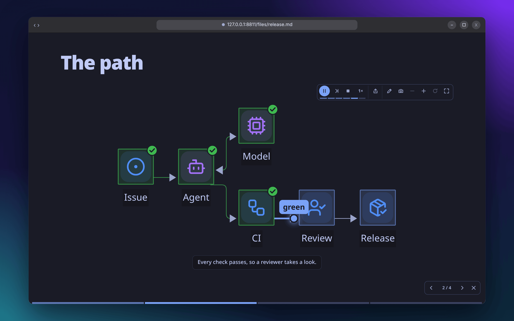
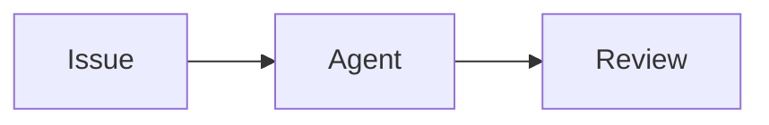

# aniflow

aniflow makes Markdown presentations with animated diagrams. Write your slides
in Markdown, add a logo, and present them in your browser. Mermaid diagrams
can play as walkthroughs: a dot travels along the arrows, boxes light up, and
captions explain each step.

It comes as a small command that serves a folder of Markdown files, and as a
JavaScript library other apps can embed.

Browse the [presentation gallery](https://chmouel.github.io/aniflow/gallery/)
or [try the editor](https://chmouel.github.io/aniflow/try/) in your browser.


## Run it

Browse the Markdown in the current directory and its subfolders:

```sh
uvx --from git+https://github.com/chmouel/aniflow aniflow serve
```

Open the URL it prints; it picks an available local port. To serve another
directory or choose the port:

```sh
aniflow serve ./docs --port 8080
```

To keep it installed, run `uv tool install git+https://github.com/chmouel/aniflow`.

## Make a presentation

Create a starter deck and open its folder:

```sh
aniflow --init talk.md              # --style keynote, conference or minimal
aniflow serve .
```

Edit `talk.md`, open it in aniflow and press Present. Each `##` heading starts
a slide; Space walks through reveals and animated diagrams, while the left and
right arrows change slides. A deck can start as simply as:

```markdown
---
title: Shipping with bots
author: Chmouel
style: conference
logo: ./logo.svg
---

## The problem

Too much waiting between steps.
```

Add `motion: none` to turn off slide animation. Press `s` while presenting for
speaker notes, and use `aniflow --slides pdf talk.md` or `--slides png` to
export a deck. `aniflow --spec` documents branding, layouts and transitions.

Documents get syntax highlighting, colour themes, a table of contents and
interactive Mermaid flowcharts. Relative links and images stay relative to
each document, including pictures in flowcharts, and the built-in `/icons/`
pictures work too.

<p align="center">
  
  
</p>

aniflow binds to `127.0.0.1` by default; use `--host` to change that. It only
reads files from the chosen directory, leaving out hidden paths and symlinks
that lead outside it. It needs Python 3.12 or newer and nothing else.

Demo & help opens a playable diagram first, followed by a walkthrough from
your first Markdown file to pictures, several stories and exports. It ships
with aniflow and works even when you serve an empty folder.

Use Comments on any page, including the demo, to comment on source lines or
on a box or arrow in a diagram, reply in a thread, edit or delete feedback,
and copy it with the quoted text for a coding agent. Comments show in a
margin beside the text when there is room, or inline under the lines. They
are kept in `$XDG_CACHE_HOME/aniflow` (usually `~/.cache/aniflow`), one file
per served folder and document. Reading and commenting leave your source
files untouched. Refresh the browser after saving changes to a document.

## Host it for a team

aniflow can also run behind a reverse proxy as a shared notes site with custom
branding, GitHub OAuth sign-in (with optional org restriction), per-user and
shared writable folders, a split-pane web editor, API tokens, and a remote CLI
(`aniflow login`, `push`, `pull`, `ls`, `search`, `comments`, `rm`).

See [`docs/hosting.md`](docs/hosting.md) for the server setup guide (Caddy,
Docker, OAuth, user folders) and [`docs/cli.md`](docs/cli.md) for the remote
CLI and agent skill commands.

## Write a walkthrough

A walkthrough is a Mermaid flowchart or sequence diagram with `%%` comment
lines that say what moves where:

````markdown

````

`aniflow --spec` prints the full syntax and the built-in icon names, handy as
a cheat sheet or for a coding agent writing diagrams.
The [walkthrough presentation](https://chmouel.github.io/aniflow/gallery/view.html?deck=walkthrough)
shows how to write and play stories; [`docs/diagram-walkthroughs.md`](docs/diagram-walkthroughs.md)
has the detailed reference.

To show a walkthrough to someone without aniflow installed,
`aniflow --share FILE` prints a link to the [online try
page](https://chmouel.github.io/aniflow/try/) with the file inside it, and
`--open` opens it in your browser as well. The text travels in the part of
the link after `#`, which browsers don't send to the server, but anyone with
the link can read it. Local pictures don't come along; the command names
the ones that won't show.

Coding agents that support skills (Claude Code, Copilot CLI, Codex and the
like) can use the bundled [`aniflow-diagrams`](skills/aniflow-diagrams/SKILL.md)
and [`aniflow-notes`](skills/aniflow-notes/SKILL.md) skills. Install or update
them with:

```sh
aniflow skill install            # into ~/.agents/skills (--claude or --project)
```

## Export a diagram to GIF or MP4

`aniflow --export` renders a document's walkthroughs in headless Chrome and
writes one file per diagram next to it, printing the paths it wrote.

```sh
aniflow --export gif walkthrough.md            # 01-walkthrough-ship-a-fix.gif
aniflow --export mp4 walkthrough.md -o clips   # 01-walkthrough-ship-a-fix.mp4
aniflow --export png walkthrough.md --diagram 2
```

The formats are `gif`, `mp4`, `webm`, and `png` for a still of each diagram.
GIF draws the story frame by frame offline and returns as fast as it encodes,
while video records it in real time, so it takes as long as the story plays. A
diagram with no `%% play:` story is skipped for both while PNG still saves it,
and a `mp4` or `webm` the browser cannot record is an error rather than the
other container in disguise. `-o/--out DIR` picks another folder and
`--diagram N` only the Nth diagram. `-` reads the document from stdin, and a
`.mmd`/`.mermaid` file, or a bare Mermaid diagram, is fenced before rendering.

It needs Google Chrome or Chromium installed; set `ANIFLOW_CHROME` to the
binary's path when it is somewhere unusual.

## Check walkthroughs

`aniflow --check FILE...` draws every diagram in headless Chrome and prints
each problem as `file:line: message`: a diagram Mermaid cannot draw, a story
step that does not play and why, and pictures that did not load. It exits 1
when it finds anything, so it fits a pre-commit hook or a docs linter. Decks
are checked even when they contain no Mermaid diagrams.

```sh
aniflow --check docs/*.md
```

## Use the library

aniflow ships built JS and CSS under `src/aniflow/static/` (`Aniflow.reader()`
for full Markdown pages, `Aniflow.diagrams()` for animating Mermaid blocks on
an existing static site) plus Python server modules (`aniflow.web`,
`aniflow.page`, `aniflow.comments`, `aniflow.themes`).

See [`docs/library.md`](docs/library.md) for the API and embed examples.

## Obsidian

[`obsidian/`](obsidian/) is an Obsidian plugin that plays walkthroughs in
reading view with the same diagram code. `npm run obsidian -- --vault
~/Notes` builds it and installs it in that vault; see
[`obsidian/README.md`](obsidian/README.md).

## Develop

```sh
npm ci
npm run build     # writes src/aniflow/static/
npm test          # node --test
uv run pytest
uv run ruff format . && uv run ruff check .
```

The built files are committed so `uvx` works without Node; `npm run check`
fails when they are out of date.
After changing a gallery deck, run
`uv run python contrib/gallery_previews.py walkthrough` (using its ID) to
regenerate its preview strip. Omit the ID to rebuild every preview. This needs
Chrome and ImageMagick 7. The walkthrough's pencil drawings can be
regenerated with `uv run --with pillow python contrib/walkthrough_illustrations.py`.
The site embeds them in its downloadable Markdown.

## License

Apache-2.0. The vendored libraries in `src/aniflow/vendor/` and the Lucide
icons keep their own licences, next to them.
