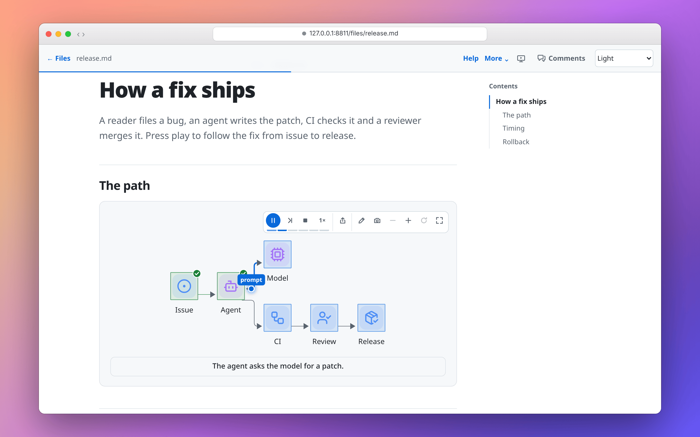
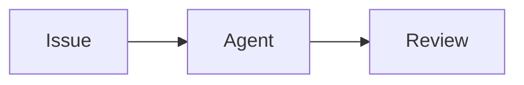

# aniflow

aniflow reads Markdown in the browser and plays its Mermaid diagrams as
animated walkthroughs: a dot travels along the arrows, boxes light up, a
caption explains each step, and a document can turn into slides.

It comes as a small command that serves a folder of Markdown files, and as a
JavaScript library other apps can embed.

The site at <https://chmouel.github.io/aniflow/> has a diagram you can play.


## Run it

Browse the Markdown in the current directory and its subfolders:

```sh
uvx --from git+https://github.com/chmouel/aniflow aniflow
```

Open the URL it prints; it picks an available local port. To serve another
directory or choose the port:

```sh
aniflow ./docs --port 8080
```

To keep it installed, run `uv tool install git+https://github.com/chmouel/aniflow`.

Documents get syntax highlighting, colour themes, a table of contents and
interactive Mermaid flowcharts. Relative links and images stay relative to
each document, including pictures in flowcharts, and the built-in `/icons/`
pictures work too.

<p align="center">
  
  
</p>

aniflow binds to `127.0.0.1` by default; use `--host` to change that. It only
reads files from the chosen directory, leaving out hidden paths and symlinks
that lead outside it. It needs Python 3.12 or newer and nothing else.

Demo & help opens a playable diagram first, followed by a walkthrough from
your first Markdown file to pictures, several stories and exports. It ships
with aniflow and works even when you serve an empty folder.

Use Comments on any page, including the demo, to comment on source lines or
on a box or arrow in a diagram, edit or delete feedback, and copy it with the
quoted text for a coding agent. Comments are kept in `$XDG_CACHE_HOME/aniflow`
(usually `~/.cache/aniflow`), one file per served folder and document.
aniflow never writes to your source files. Refresh the browser after saving changes to a
document.

## Write a walkthrough

A walkthrough is a Mermaid flowchart or sequence diagram with `%%` comment
lines that say what moves where:

````markdown

````

`aniflow --spec` prints the full syntax and the built-in icon names, handy as
a cheat sheet or for a coding agent writing diagrams.
[`docs/diagram-walkthroughs.md`](docs/diagram-walkthroughs.md) shows every
feature in a live document.

To show a walkthrough to someone without aniflow installed,
`aniflow --share FILE` prints a link to the [online try
page](https://chmouel.github.io/aniflow/try/) with the file inside it, and
`--open` opens it in your browser as well. The text travels in the part of
the link after `#`, which browsers don't send to the server, but anyone with
the link can read it. Local pictures don't come along; the command names
the ones that won't show.

Coding agents that support skills (Claude Code, Copilot CLI, Codex and the
like) can use [`skills/aniflow-diagrams`](skills/aniflow-diagrams/SKILL.md):
copy or link that folder into the agent's skills directory and it will draw
walkthroughs that look good.

## Export a diagram to GIF or MP4

`aniflow --export` renders a document's walkthroughs in headless Chrome and
writes one file per diagram next to it, printing the paths it wrote.

```sh
aniflow --export gif walkthrough.md            # 01-walkthrough-ship-a-fix.gif
aniflow --export mp4 walkthrough.md -o clips   # 01-walkthrough-ship-a-fix.mp4
aniflow --export png walkthrough.md --diagram 2
```

The formats are `gif`, `mp4`, `webm`, and `png` for a still of each diagram.
GIF draws the story frame by frame offline and returns as fast as it encodes,
while video records it in real time, so it takes as long as the story plays. A
diagram with no `%% play:` story is skipped for both while PNG still saves it,
and a `mp4` or `webm` the browser cannot record is an error rather than the
other container in disguise. `-o/--out DIR` picks another folder and
`--diagram N` only the Nth diagram. `-` reads the document from stdin, and a
`.mmd`/`.mermaid` file, or a bare Mermaid diagram, is fenced before rendering.

It needs Google Chrome or Chromium installed; set `ANIFLOW_CHROME` to the
binary's path when it is somewhere unusual.

## Use the library

The built files live in `src/aniflow/static/`: `aniflow.min.js` (a script
that defines the `Aniflow` global), `aniflow.esm.js` (an ES module),
`aniflow.css` (the reader and diagrams) and `page.css` (the page around
them). They expect markdown-it with its footnote and emoji plugins,
DOMPurify and github-markdown.css on the page; highlight.js is optional, and
Mermaid is loaded on demand from the `mermaid` URL.

```html
<article class="markdown-body"></article>
<script src="/vendor/markdown-it.min.js"></script>
<script src="/vendor/markdown-it-footnote.min.js"></script>
<script src="/vendor/markdown-it-emoji.min.js"></script>
<script src="/vendor/purify.min.js"></script>
<script src="/static/aniflow.min.js"></script>
<script>
  Aniflow.reader({
    source: '# Hello\n\nSome *markdown*.',
    mermaid: '/vendor/mermaid.min.js',
  });
</script>
```

`Aniflow.reader()` takes:

- `article`, `toc`, `bar`: elements or selectors for the document, the table
  of contents and a top bar that shows reading progress
- `source`, `breaks`, `callouts`: the markdown, whether single newlines break
  lines, and whether Obsidian-style callouts are drawn
- `plugins`, `preprocess`: markdown-it plugins, and a function applied to the
  text first
- `resolveLink`, `resolveImage`: return the URL a relative link or picture
  points at, or null to leave it alone; `Aniflow.directoryResolver(root)`
  keeps them under a served folder
- `nonce`: the page's CSP nonce, given to the Mermaid script
- `comments`: `{url, max, name}` to turn on line and diagram review against
  an aniflow-style comments endpoint, with `reviewButton` and `reviewDock`
- `presentButton`: the button that starts slides

Call `Aniflow.reader()` once per page: the markdown-it setup and the event
handlers it installs stay for the life of the page. It returns
`{ update(source) }`, which renders new Markdown into the same article, as
an editor with a live preview needs.

The Python package also exposes the server pieces (`aniflow.web`,
`aniflow.page`, `aniflow.comments`, `aniflow.themes`) for apps that serve the reader themselves.

## Develop

```sh
npm ci
npm run build     # writes src/aniflow/static/
npm test          # node --test
uv run pytest
uv run ruff format . && uv run ruff check .
```

The built files are committed so `uvx` works without Node; `npm run check`
fails when they are out of date.

## License

Apache-2.0. The vendored libraries in `src/aniflow/vendor/` and the Lucide
icons keep their own licences, next to them.
