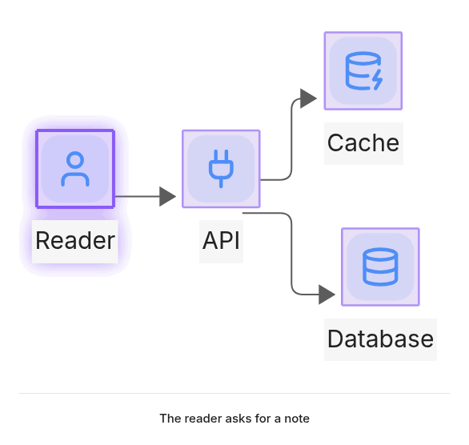

# Aniflow for Obsidian

Aniflow animates Mermaid diagrams in Obsidian's reading view. Add `%%` lines
under a flowchart or a sequence diagram and a dot follows the arrows, lighting
each box it reaches, while a caption under the diagram explains the step.



````markdown
```mermaid
flowchart LR
  U@{ img: "/icons/user.svg", label: "Reader", w: 48, h: 48, constraint: "on" }
  A@{ img: "/icons/api.svg", label: "API", w: 48, h: 48, constraint: "on" }
  D@{ img: "/icons/database.svg", label: "Database", w: 48, h: 48, constraint: "on" }
  U --> A --> D

%% play: Read a note
%% U -> A : GET | The reader asks for a note
%% A -> D : query
%% D -> A : row
%% A -> U : 200 | The note comes back
```
````

Mermaid treats `%%` lines as comments, so GitHub and other Markdown tools
draw the plain diagram.

## Features

- Play, pause, step forward and back, change speed, or jump along the rail
- Several stories per diagram (`%% play:` starts each one)
- Pan, zoom and full screen; click a box to highlight it and its neighbours
- A pen and a laser pointer for presenting
- Save the diagram as PNG, GIF or video; the file lands where Obsidian keeps
  the note's attachments
- Over 100 built-in icons (`/icons/<name>.svg`), or pictures from your vault
  (`img: "attachments/db.png"`), found the way a link from the note would be
- Colours from your Obsidian theme, light or dark

The plugin leaves diagrams without a `%% play:` story to Obsidian. With
"Draw every Mermaid diagram" on in its settings, it draws those too, for pan,
zoom and full screen.

## Syntax

The full reference for the `%%` lines (stories, captions, fan-out, waits,
skips, sequence diagrams, icons) is
[the walkthrough reference](https://github.com/chmouel/aniflow/blob/main/src/aniflow/spec.md).

## Limits

- Reading view only. Live Preview draws Mermaid without going through
  plugins, so walkthroughs show there as still diagrams.
- The plugin carries its own copy of Mermaid (about 5 MB), because the
  walkthrough player needs Mermaid's SVG and Obsidian now draws diagrams with
  a different renderer. It loads when the first diagram the plugin draws comes
  near the screen, and leaves Obsidian's own diagrams alone.

## Source

The plugin is built from [chmouel/aniflow](https://github.com/chmouel/aniflow),
which also holds the aniflow Markdown reader and presentation tool. The
Obsidian glue is in
[`obsidian/`](https://github.com/chmouel/aniflow/tree/main/obsidian), and the
diagram code it shares with aniflow is in
[`js/diagram/`](https://github.com/chmouel/aniflow/tree/main/js/diagram). This
repository only holds the release files.

To build it yourself:

```sh
git clone https://github.com/chmouel/aniflow && cd aniflow
npm ci
npm run obsidian -- --vault ~/path/to/vault
```

That writes `obsidian/dist/` and copies it to
`<vault>/.obsidian/plugins/aniflow/`. Then turn on Aniflow under
Settings > Community plugins.

## Releasing

A tag `obsidian-X.Y.Z` on chmouel/aniflow, with `X.Y.Z` matching
`obsidian/manifest.json`, runs the `obsidian` workflow. It builds the plugin,
copies `manifest.json`, `versions.json`, this README, `demo.gif` and the
licence to chmouel/aniflow-obsidian, and creates the `X.Y.Z` release there with
`main.js`, `manifest.json` and `styles.css`. Add the new version and its
`minAppVersion` to `versions.json` before tagging.

## Licence

Apache-2.0. The bundled Mermaid is MIT and the icons come from Lucide (ISC).
