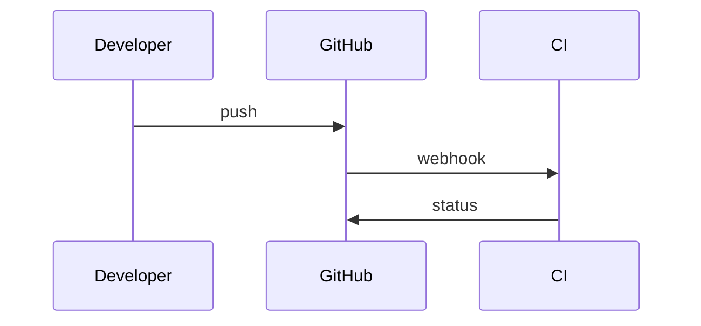

# Diagram walkthrough reference

This is the syntax for animated Mermaid diagrams, as played by `aniflow` and
every reader built on it. Print it with `aniflow --spec`.
Preview a document with `aniflow <dir>` and open the URL it prints. Other
Mermaid renderers, GitHub included, ignore the `%%` lines and draw a plain
diagram.

## Where the script goes

A walkthrough lives inside an ordinary ```` ```mermaid ```` fence, after the
diagram, as `%%` comment lines. Only `flowchart` (or `graph`) and
`sequenceDiagram` play, after optional front matter. Other diagram types get
pan and zoom only.

````markdown
```mermaid
flowchart LR
  U@{ img: "/icons/user.svg", label: "User", w: 48, h: 48, constraint: "on" }
  A@{ img: "/icons/api.svg", label: "API", w: 48, h: 48, constraint: "on" }
  D@{ img: "/icons/database.svg", label: "Database", w: 48, h: 48, constraint: "on" }
  U --> A --> D

%% play: Read a record
%% U -> A : GET | The user asks for a record
%% A -> D : query
%% D -> A : row
%% A -> U : 200 | The answer comes back
```
````

## Directives

```text
%% play: Title            starts a story; the title shows in the story picker
%% A -> B                 a dot travels from node A to node B
%% A -> B : label         the same, with a short tag riding on the dot
%% A -> B : label | text  the same, with a caption shown under the diagram
%% A -> B | text          a caption without a label
%% A -> B, C              one dot down each edge at the same time (fan-out)
%% A, B -> C              dots from A and from B meet at C (fan-in)
%% A -> B & C             same as the comma form
%% A -> B @ok             takes the edge declared in Mermaid as A ok@--> B
%% A -> B @ok, C          an edge id can follow any box in a list
%% skip A B               fades these nodes until the story ends
%% skip A B | text        the same, with a caption
%% wait 1500              holds the picture for 1.5 s before the next step
%% wait 1500 | text       the same, with a caption shown during the wait
```

## Rules

- Steps name nodes by their Mermaid id (the `R` in `R[Run step]`), never by
  their label. `->` and `-->` mean the same thing in a step.
- A step needs an edge between its two nodes. An edge drawn the other way
  (`B --> A`, or `A <--> B`) is followed backwards.
- When several edges join the same two nodes, a plain step takes the first
  one drawn. To choose, give the edges ids in Mermaid
  (`T ok@-->|pass| D` and `T bad@-->|fail| D`) and name one in the step
  (`%% T -> D @ok`). The named edge must join the two nodes of the step.
- In a list, each dot moves at its own edge's pace and the step ends when
  the last dot arrives. The label rides on the first dot only. If any pair
  in the list has no edge, the whole step is dropped. Several boxes on both
  sides (`A, B -> C, D`) is ambiguous and dropped; write one step per edge.
- A caption shows only while its step plays. A step without one hides the
  caption.
- `wait` takes whole milliseconds. Consecutive waits add up, capped at
  10000. A wait after the last step holds the finished picture. Waits follow
  the speed control. Step mode runs through a wait with the step after it.
- Steps written before the first `play:` form a story called Walkthrough.
  Any other `%%` comment is ignored.
- One diagram can hold several stories. Use them for different paths through
  the same picture, with `skip` for the boxes a path does not use.

## Sequence diagrams

The names are participant ids. Each step lights up the next message from the
first participant to the second, counting from the message the previous step
used, and wraps to the top once. The direction must match: `GH -> Dev` never
matches `Dev->>GH`. Self messages (`P -> P`) work. Lists work. Edge ids do
not exist there, so a step with `@id` is dropped.

````markdown

````

## Pictures in boxes

```text
A@{ img: "/icons/agent.svg", label: "Agent", w: 48, h: 48, constraint: "on" }
```

Always set `w`, `h` and `constraint: "on"`. aniflow adds a missing
`constraint: "on"` itself, but other Mermaid renderers stretch the picture
without it.
`pos: "t"` puts the label above the picture. Allowed sources:

- a path relative to the document, such as `icons/build.svg`
- a built-in icon, `/icons/<name>.svg` (listed below)
- an `https://` URL
- a `data:image/` URL for PNG, JPEG, GIF, WebP or SVG

Anything else, `http:` included, becomes a grey placeholder, and so does a
picture that fails or takes longer than eight seconds to load. The
diagram's tooltip names them. GitHub cannot reach `/icons/` or relative
pictures inside a diagram; use https pictures when it must look right there.

A custom picture in the same style is a 48×48 SVG: a rounded square tinted
at 12% opacity with a stroked symbol in one colour.

### Built-in icons

Agents and models are violet, waiting and secrets amber, failures and
refusals red, success green, everything else blue.

| Group | Names |
| --- | --- |
| People and agents | `user` `users` `reviewer` `agent` `model` `brain` `skill` `prompt` `sparkles` `tool` |
| Git and forges | `issue` `pull-request` `commit` `branch` `merge` `fork` `repository` `tag` `release` `comment` `review` `diff` `code` `file-code` |
| Events and CI | `event` `webhook` `listener` `trigger` `pipeline` `task` `step` `test` `build` `deploy` `rerun` `follow-up` `schedule` `queue` `wait` `timer` `clock` `check` `success` `fail` `warning` `bug` `fix` `stop` `play` `pause` |
| Platform | `cluster` `node` `pod` `container` `namespace` `service` `network` `ingress` `route` `load-balancer` `database` `storage` `cache` `cloud` `registry` `image` `config` `operator` `controller` `api` `terminal` `cli` `laptop` `phone` `browser` `globe` |
| Security and identity | `identity` `fingerprint` `key` `token` `secret` `unlock` `policy` `shield` `refuse` `audit` `certificate` |
| Data and output | `logs` `report` `document` `folder` `search` `inspect` `metrics` `monitor` `dashboard` `alert` `notification` `mail` `chat` `upload` `download` `link` `filter` `decision` `idea` |

## When a step cannot play

A step that names a missing node, joins two nodes with no edge, names an
unknown edge id or has a `wait` without a number is dropped, and the rest
plays. A warning badge with a count appears in the diagram toolbar; opening
it lists each dropped step with its story, its document line and the reason.
The same list goes to the browser console. A block where no step works gets
the badge and no play button. Check for the badge after every edit.

## Playback and presenting

Playing lights the first node, moves the dot along the edge, ticks the node
it leaves and lights the one it reaches. When the story ends, the final
picture stays. Viewers can step with the arrow keys, change speed, click a
box to spotlight it and its neighbours, draw on the diagram, and save a PNG,
GIF or video.

The Present button turns a document into slides, one per `##` section, and
the arrow keys play a diagram's story before moving to the next slide. See
Slides below.

A link like `#diagram=2&story=1&step=3&focus=A,B` opens the second diagram
in full screen with its first story stopped after three steps and boxes A
and B spotlit. Every part is optional.

In full screen, the comment button lets a reader comment on a box, an arrow
or the whole diagram. Such a comment is stored as a line comment on the
fence line that declares the box or arrow, so the copied prompt reads
`file.md:9 (diagram 1, box "Build")` followed by that line and the comment.
Declaring an edge id (`ok@-->`) gives each arrow its own line to anchor to.

## Slides

A document presents as a deck: one slide per `##` section, or per `#` when
there are several. Every slide is drawn on a fixed 1600×900 canvas (1200
tall with `aspect: 4:3`) scaled to the screen, so it looks the same on a
laptop, a projector and in the PDF. Text that does not fit shrinks a little;
what still spills is reported by `--check`.

Settings live in HTML comments, which GitHub and other Markdown viewers
hide, so the same file still reads as a plain document.

### Front matter

```yaml
---
title: Shipping with bots   # with author and date, makes a cover slide
author: Chmouel
date: May 2026
style: conference   # keynote, conference, minimal
theme: dracula      # dark, light, dracula, tokyo-night, rose-pine, rose-pine-dawn
accent: "#cc2244"   # blue, violet, green, amber, red, or a quoted hex colour
font: modern        # modern, classic, mono, rounded
footer: KubeCon 2026
logo: ./logo.svg    # a picture, top right of every slide
logo-dark: ./white-logo.svg # optional logo on dark slides
numbers: true       # slide numbers in the footer
aspect: 16:9        # or 4:3
transition: slide   # slide, fade, zoom, morph, none
motion: subtle      # subtle or none
autoplay: true      # play a slide's diagram story when the slide opens
---
```

A `title` adds a cover slide unless the document already opens with a `#`
heading, which becomes the cover itself.

The three styles set coordinated defaults for colour, font and motion, and
each has its own look: Keynote is dark with a large cover title and big
section numbers; Conference puts section slides on the accent colour, rules
under slide titles and turns on slide numbers; Minimal drops the cover glow,
the accent bars and the card fills for plain type and hairlines. Explicit
front matter overrides a style, and a section's own `bg=` wins over
Conference's accent. Slide directives override deck transitions. Without a style,
existing defaults apply. `motion: none` stops slide and reveal animation;
reduced-motion browser preferences do the same. Logos can be paths, HTTPS
URLs or embedded image data URLs.

Create a ready-to-edit deck with `aniflow --init talk.md` and choose a style
with `--style keynote`, `--style conference` or `--style minimal`.

### Directives

```markdown
<!-- slide: layout=columns bg=muted reveal -->
## Two ways to ship

By hand, every step waits for someone.

<!-- column -->

With a bot, the waiting goes away.

<!-- notes:
Pause here. Ask who reviewed a PR at midnight this week.
-->
```

- `<!-- slide: ... -->` sets options for the slide that follows. Without a
  heading after it, it still starts a new slide.
- `layout=NAME`, or the name alone: `title`, `cover`, `section`, `center`,
  `columns`, `split`, `quote`, `stat`, `full`, `grid`.
- `bg=` one of `accent`, `muted`, `inverse`, `gradient`, `none`, or a
  picture path. A picture fills the slide under a scrim that keeps text
  readable; add `dim` for a darker one.
- `flip` puts the picture of a `split` slide on the right.
- `reveal` shows the slide's list items and blocks one key press at a time.
- `story=N` plays the diagram's Nth story on that slide.
- `transition=` overrides the deck transition for that slide.
- `<!-- column -->` starts the next column of a `columns` slide. Columns
  run from the heading to the end of the slide.
- `<!-- reveal -->` reveals only the list or block right after it.
- `<!-- notes: ... -->` holds speaker notes, Markdown allowed. They show in
  the presenter window only.
- A code fence with `{1-3|5|all}` after its language highlights those
  lines one key press at a time: ` ```js {1-3|5|all} `.

Values outside these lists are reported by `--check` and ignored.

### Layouts

A slide with no `layout` gets one from what it holds:

| The slide holds | Layout |
| --- | --- |
| a `#` heading and a short paragraph, first in the deck | `cover` |
| a heading alone | `section` |
| one blockquote | `quote` |
| one picture | `full` |
| one diagram and up to a few lines of text | `full` |
| one picture with a list or short text | `split` |
| a paragraph opening with a bold number, `**42%** fewer rounds` | `stat` |
| one list of 2 to 6 items, each opening with bold text | `grid` |
| text split by `<!-- column -->` | `columns` |
| anything else | `title` |

Name a layout only when the automatic one is wrong. `center` centres
whatever the slide holds.

### Presenting

Keys: arrows, Space, `j`/`k` and PageDown/PageUp step through reveals, code
steps and the diagram story, then move on; `n`/`b` jump a whole slide;
Home/End; `o` shows every slide as a grid; `s` opens the presenter window
with the current and next slide, notes, a timer and the clock, kept in sync
with the main window; `l` turns on a laser pointer; Escape leaves. The link
keeps `#slide=N&step=K`.

### Checks and export

`aniflow --check deck.md` presents every slide in headless Chrome and
prints, as `file:line`: text that does not fit even when shrunk, slides over
90 words, unknown options, layouts and front matter values, a `columns`
slide with one column, a `split` or `full` slide with nothing to show,
backgrounds, logos and pictures that do not load, and notes in a document
with no slides. A document is checked as a deck only when it has a slide
directive, notes, columns, reveal or one of the deck front matter keys, so
a README with `##` sections reports nothing.

`aniflow deck.md --slides pdf` writes `deck.pdf`, one page per slide with
every reveal shown and every story played to the end; `--slides png`
writes `deck-01.png` and so on, at twice the canvas size. `-o DIR` picks
the folder.
