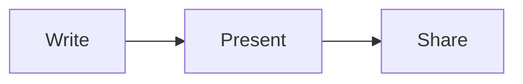

## Start with Markdown

Each heading starts a new slide.

<!-- slide: bg=accent transition=zoom -->
## Change the background

A single setting changes the mood of this slide.

<!-- slide: reveal -->
## Reveal ideas as you speak

- One idea at a time.
- The arrow key reveals the next.

<!-- notes: Ask the audience what they would like to explain. -->

## Walk through a diagram



## Highlight code

```js {1|2|all}
const talk = write('Markdown');
present(talk);
```

<!-- slide: center -->
## Your turn

Edit this deck and make it your own.
