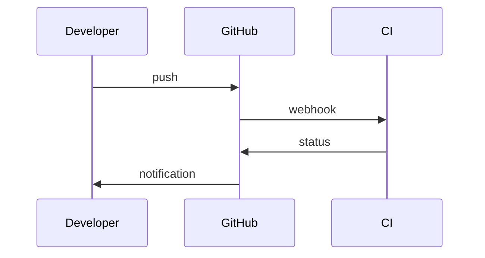

<!-- notes: This is a hands-on tour of aniflow's Mermaid walkthroughs. Use the arrow keys to step through the diagrams, then move to the next slide. Press S to see these notes. -->

## A diagram can tell a story

A dot travels along the arrows. Boxes light up. Captions explain what is happening.

<!-- notes: A walkthrough is an ordinary Mermaid flowchart or sequence diagram with a small script written in Mermaid comments. Other Mermaid renderers ignore the script and draw the diagram normally. -->

## Follow a request

```mermaid
flowchart LR
  User@{ img: "/icons/user.svg", label: "User", w: 48, h: 48, constraint: "on" }
  API@{ img: "/icons/api.svg", label: "API", w: 48, h: 48, constraint: "on" }
  DB@{ img: "/icons/database.svg", label: "Database", w: 48, h: 48, constraint: "on" }
  User --> API --> DB

%% play: Read a record
%% User -> API : GET | The user asks for a record.
%% API -> DB : query
%% DB -> API : row
%% API -> User : 200 | The answer comes back.
```

<!-- notes: Press Right to play each step. The return path follows the same arrows backwards. A box is checked when the dot leaves it. -->

## Write the story in Mermaid comments

```text
%% play: Read a record
%% User -> API : GET | The user asks.
%% API -> DB : query
%% DB -> API : row
```

<!-- notes: Put these lines inside the Mermaid fence, after the flowchart. The part after the colon rides on the dot. The part after the vertical bar is a caption. Both are optional. -->

## Use the node IDs

```text
API[Customer API] --> DB[Records]

%% API -> DB : query
```

Steps name `API` and `DB`, not their labels. Each step needs an edge.

<!-- notes: A step can follow an edge backwards. If an ID is missing or the edge does not exist, aniflow drops that step and reports why. -->

## One picture, more than one story

```mermaid
flowchart LR
  Push@{ img: "/icons/commit.svg", label: "Push", w: 48, h: 48, constraint: "on" }
  Test@{ img: "/icons/test.svg", label: "Tests", w: 48, h: 48, constraint: "on" }
  Ship@{ img: "/icons/deploy.svg", label: "Deploy", w: 48, h: 48, constraint: "on" }
  Fix@{ img: "/icons/fix.svg", label: "Fix", w: 48, h: 48, constraint: "on" }
  Push --> Test
  Test --> Ship
  Test --> Fix
  Fix --> Push

%% play: Green build
%% skip Fix
%% Push -> Test : commit
%% Test -> Ship : pass | The tests pass and the change ships.
%% play: Red build
%% skip Ship
%% Push -> Test : commit
%% Test -> Fix : fail | A failing test needs a fix.
%% Fix -> Push : retry
```

<!-- notes: Open the story picker on the diagram to switch between Green build and Red build. Each story has its own play line; skip fades the box that story does not use. -->

## Give each path a name

```text
%% play: Green build
%% skip Fix
%% Push -> Test : commit
%% Test -> Ship : pass
```

Add another `%% play:` for another story.

<!-- notes: Steps before the first play directive form a story named Walkthrough. Skipped nodes can become active again if a later step reaches them. -->

## Show work happening in parallel

```mermaid
flowchart LR
  Push@{ img: "/icons/commit.svg", label: "Push", w: 48, h: 48, constraint: "on" }
  Lint@{ img: "/icons/inspect.svg", label: "Lint", w: 48, h: 48, constraint: "on" }
  Test@{ img: "/icons/test.svg", label: "Tests", w: 48, h: 48, constraint: "on" }
  Gate@{ img: "/icons/decision.svg", label: "Checks", w: 48, h: 48, constraint: "on" }
  Push --> Lint & Test
  Lint & Test --> Gate

%% play: Checks
%% Push -> Lint, Test | One push starts both jobs.
%% Lint, Test -> Gate | Both results meet at the gate.
```

<!-- notes: Every pair in a list must have an edge. Each dot travels at its own pace, and the step ends when the last one arrives. Listing multiple nodes on both sides is ambiguous, so use separate steps. -->

## Fan out and meet again

```text
%% Push -> Lint, Test
%% Lint, Test -> Gate
```

The step finishes when the last dot arrives.

## Choose between two arrows

```text
Test ok@-->|pass| Deploy
Test bad@-->|fail| Deploy

%% Test -> Deploy @bad : fail
```

An edge ID picks the path to follow.

<!-- notes: Without an edge ID, a step takes the first edge drawn between those nodes. The named edge has to join the two nodes in the step. -->

## Hold a moment

```text
%% Push -> Test : commit
%% wait 1200 | The tests are running.
%% Test -> Deploy : pass
```

`wait` is in milliseconds and follows the speed control.

<!-- notes: Consecutive waits add up to at most ten seconds. Step mode runs through a wait with the following step; waits do not add ticks to the rail. -->

## Animate a conversation



<!-- notes: Sequence steps use participant IDs and match messages in their declared direction. Repeated pairs advance through matching messages in order. Self messages and lists work too. -->

## Put pictures in boxes

```text
Bot@{ img: "/icons/agent.svg",
      label: "Agent", w: 48, h: 48,
      constraint: "on" }
```

Use a built-in icon, a relative file, an HTTPS URL or an image data URL.

<!-- notes: Run aniflow --spec for the built-in icon names. The width, height and constraint keep pictures proportionate. Missing or refused pictures become placeholders, with details in the diagram tooltip. -->

## Play at your own pace

- Use the arrow keys to step forward and back.
- Space steps forward; Shift+Space steps back.
- The toolbar plays, pauses, changes speed and switches stories.

<!-- notes: J and K or Page Down and Page Up also step. Click a tick in the rail to jump to that step. Speed is remembered in the browser. -->

## Follow the action

Turn on the camera to follow the active arrow and its boxes.

Drag, zoom or pan whenever you want to take over.

<!-- notes: Camera follow is off by default and is remembered in the browser. It resumes on the next step after a manual pan or zoom. Reduced-motion settings disable camera movement. -->

## Spotlight what matters

Click a flowchart box to highlight it and its neighbours.

Shift-click adds another box. Escape clears the spotlight.

<!-- notes: A playing story stays bright even when the spotlight is on. Click the selected box or the background to clear it too. Spotlight applies to flowcharts, not sequence participants. -->

## Draw while you talk

Turn on the pen for a laser trail. Drag to draw a stroke on the diagram.

<!-- notes: Strokes move and scale with the diagram. Escape clears them. PNG includes strokes; GIF and video exports do not. The laser trail is never exported. -->

## Comment on a diagram

In the local reader, open a diagram full screen and choose the comment button.

Click a box, an arrow or the background to leave feedback.

<!-- notes: Comments are available where the host provides comment storage. The public site is read-only and does not provide the comment panel. Local comments attach to the corresponding Markdown source line and live outside the served folder. -->

## Link to a moment

Use the diagram's share menu to copy a link to the current story, step and spotlight.

<!-- notes: The link opens the selected diagram full screen at that point. Diagram and story numbers start at one. Each part of the hash is optional. -->

## Save the diagram

- **PNG:** the view as it looks now.
- **GIF:** a looping story, rendered offline.
- **MP4 or WebM:** a video recorded as it plays.

<!-- notes: Use the diagram's share menu. Export happens in the browser. GIF and video use the fitted view; PNG preserves the current zoom and spotlight. -->

## Check before you share

```sh
aniflow --check talk.md
aniflow --export gif talk.md
```

The check reports missing pictures, broken diagrams and dropped steps by line.

<!-- notes: A warning badge on the diagram reports dropped steps in the browser. A step with a missing node, edge or edge ID is skipped rather than breaking the whole story. -->

## Make it a presentation

Each `##` heading starts a slide. Present mode plays a diagram's steps before moving on.

<!-- notes: Use N and B to skip a whole slide, O for the overview and S for the presenter window. aniflow --slides pdf talk.md makes a handout; --slides png writes one image per slide. -->

## Try it yourself

Open the editor, change a story and play it.

Run `aniflow --spec` for the full syntax and icon list.

<!-- notes: Start with a normal Mermaid diagram. Add a short story for something that happens in order. Check the result and keep captions for the moments that need explanation. -->
