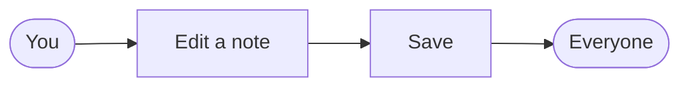

# Welcome, {login}

This folder is yours. Everyone signed in can read it, and only you can change
it. Open a note and press **Edit**, or **New note** in the folder list. Notes
are plain Markdown, so everything below is what you would write on GitHub.

## Writing

Plain paragraphs, **bold**, *italic*, `inline code` and
[links](https://github.com/chmouel/aniflow).

- a list
- with items
  - and nested ones

1. numbered
2. steps

- [x] a task that is done
- [ ] one that is not

> A quote.

> [!TIP]
> GitHub alerts work too: NOTE, TIP, IMPORTANT, WARNING and CAUTION.

| Command | What it does |
| --- | --- |
| `tkn pr ls` | lists PipelineRuns |
| `tkn pr logs -f` | follows the last one |

```bash
kubectl get pipelineruns -n my-namespace
```

## A diagram that plays

A Mermaid flowchart becomes a walkthrough with `%%` lines after it: press
play on the diagram, or step through it with the arrow keys.



The full syntax, with pictures, several stories and sequence diagrams, is on
the [aniflow site](https://chmouel.github.io/aniflow/); the **Help** link in
the bar has a demo.

## Slides

Press **Present** in the bar: every `##` heading starts a new slide.
