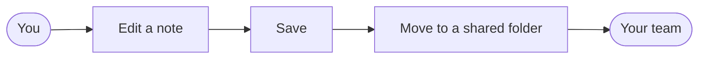

# Welcome, {login}

This folder is yours, and only you can read or change it. Nobody else sees
it, signed in or not, so it is the place for drafts and personal notes. Open a
note and press **Edit**, or **New note** in the folder list. Notes are plain
Markdown, so everything below is what you would write on GitHub.

## Sharing a note

When a note is ready for others, move it out of here into a shared folder.
Shared folders sit at the top of **Files**, one per team or topic (say `pac/`
for Pipelines-as-Code, `design/` for design docs), and every signed-in member
can write in them. Pick the one that fits the subject rather than a catch-all,
so people find things by browsing. If no folder fits, ask whoever runs this
server to make one.

From a terminal, with the `aniflow` client:

```bash
aniflow whoami              # your folder and the shared folders you can write to
aniflow mv plan.md pac/     # moves plan.md from your folder to pac/plan.md
```

Or open the shared folder in the browser, press **New note** and paste the
text in. Once it is there, anyone can read it: add `private: true` to its
front matter (or use **Private** in the editor) to keep it to signed-in
members. Pictures in your `images/` folder and comments stay behind when a
note moves, so copy the pictures it needs along with it.

## Writing

Plain paragraphs, **bold**, *italic*, `inline code` and
[links](https://github.com/chmouel/aniflow).

- a list
- with items
  - and nested ones

1. numbered
2. steps

- [x] a task that is done
- [ ] one that is not

> A quote.

> [!TIP]
> GitHub alerts work too: NOTE, TIP, IMPORTANT, WARNING and CAUTION.

| Command | What it does |
| --- | --- |
| `tkn pr ls` | lists PipelineRuns |
| `tkn pr logs -f` | follows the last one |

```bash
kubectl get pipelineruns -n my-namespace
```

## A diagram that plays

A Mermaid flowchart becomes a walkthrough with `%%` lines after it: press
play on the diagram, or step through it with the arrow keys.



The full syntax, with pictures, several stories and sequence diagrams, is on
the [aniflow site](https://chmouel.github.io/aniflow/); the **Help** link in
the bar has a demo.

## Slides

Press **Present** in the bar: every `##` heading starts a new slide.
